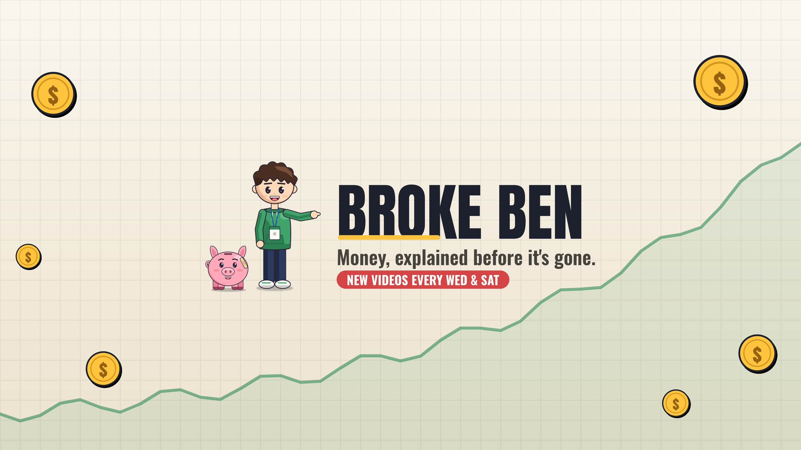
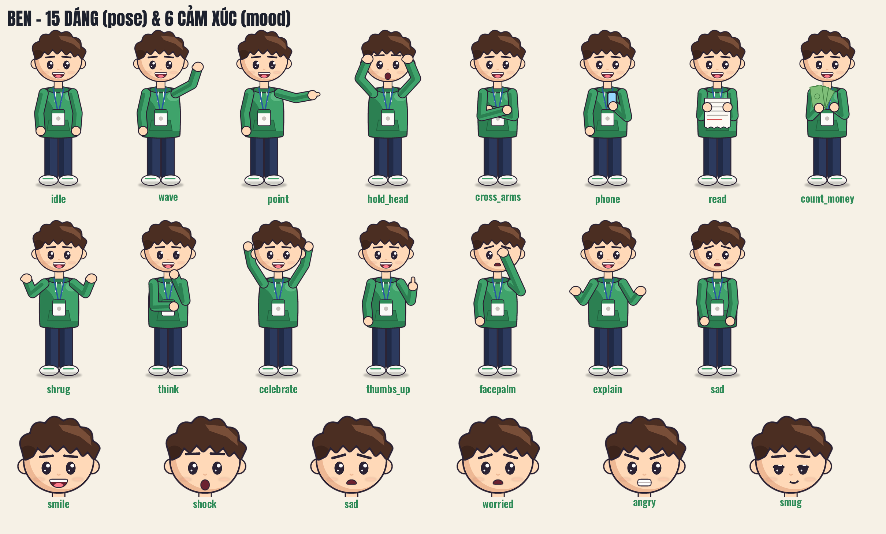

# Money Studio – tool làm video cho kênh Broke Ben

Tool Windows biến kịch bản JSON thành video hoạt hình tài chính hoàn chỉnh cho kênh **Broke Ben**
(*Money, explained before it's gone.*). Tool dùng **giọng Kokoro có sẵn trên máy** (`E:\LocalTTS`), giống
Horror Studio và Relatable Studio, nên không cài lại giọng đọc.

## Cài lần đầu (1 lần)
1. Chép cả thư mục này về máy, ví dụ `E:\MoneyStudio`.
2. Nháy đúp **`setup.bat`**. Tool sẽ:
   - tạo môi trường Python riêng (thư mục `env`), không đụng vào `E:\LocalTTS`, Horror Studio hay Relatable Studio;
   - cài Pillow, numpy, ffmpeg, anthropic (cần Internet);
   - kiểm tra Kokoro ở `E:\LocalTTS\env_en`;
   - tạo lối tắt **Money Studio** trên Desktop.
3. Mở app → tab **3. Giọng đọc & cài đặt** → bấm **Kiểm tra kết nối**, rồi **Nghe thử**.
   Nếu Kokoro nằm chỗ khác, bấm **Chọn...** để trỏ tới `python.exe` của Kokoro và thư mục `hf_cache`.

**Cài đặt riêng của bạn** (đường dẫn Kokoro, API key, âm lượng...) lưu trong `config.json`. File này không nằm trong git,
nên `git pull` không bao giờ ghi đè nó. Giá trị mặc định nằm ở `config.default.json` (đừng sửa file này).

## Dùng hằng ngày
1. **Lấy kịch bản** (tab 2):
   - Miễn phí: nhập chủ đề → **Copy prompt** → dán vào Claude chat → copy JSON trả về → **Dán từ clipboard** → **Lưu vào scripts**.
   - Tự động (tính phí theo API): nhập API key ở tab 3 → **VIẾT BẰNG API**.
   - Mỗi câu trong kịch bản có cả tiếng Anh (`text`, để đọc) và tiếng Việt (`vi`, để làm phụ đề và để bạn đọc hiểu).
     Thiếu tiếng Việt thì bấm **Dịch phụ đề tiếng Việt còn thiếu (API)**.
2. **Xem trước** (tab 1): chọn kịch bản, kéo thanh **Cảnh** để xem từng cảnh. Ô bên dưới hiện lời đọc **Anh + Việt** của cảnh đó.
3. **Chọn phụ đề trên video**:
   - **Tiếng Anh**: bản để đăng YouTube (khán giả Mỹ/Anh/Canada/Úc).
   - **Tiếng Việt**: bản để bạn xem duyệt nội dung cho dễ hiểu. Không nên đăng bản này lên kênh tiếng Anh.
   - **Không phụ đề**.
   Dù chọn gì, tool luôn xuất kèm `subtitles_en.srt` và `subtitles_vi.srt`.
4. Lần đầu nên tick **Chỉ xuất 40 giây đầu** để nghe giọng và xem hình. Muốn test hình thật nhanh: tick **Thử nhanh không giọng**.
5. Bấm **XUẤT VIDEO**. Kết quả nằm trong `output\<ngày>_<tên>`:

| File | Là gì |
|---|---|
| `video.mp4` | Video 1920x1080, 30 khung/giây |
| `shorts.mp4` | Bản dọc 1080x1920 dưới 60 giây (từ các cảnh đầu hoặc `shorts.scenes`) |
| `thumbnail_A/B/C.jpg` | 3 thumbnail để thử bằng YouTube Studio > Test & Compare |
| `subtitles_en.srt`, `subtitles_vi.srt` | Phụ đề Anh và Việt, khớp thời gian giọng đọc |
| `youtube.txt` | Tiêu đề (kèm nghĩa tiếng Việt), mô tả có chương + số liệu + miễn trừ, tags, bình luận ghim, cài đặt khi đăng |
| `render_report.txt` | Thời lượng, bộ mã hóa, các lưu ý về kịch bản |

## Video trông như thế nào
- Nhân vật **Ben** (người trẻ đi làm: tóc rối kiểu hiện đại, hoodie xanh, thẻ nhân viên đeo cổ) với **25 dáng và 9 cảm xúc** (xem `docs/ben_poses.png`),
  và **Piggy Ben** (heo đất nứt dán băng, vai phụ). Nhân vật thở, chớp mắt, **mấp máy miệng theo giọng đọc**, nhảy lên khi sốc hoặc ăn mừng.
- Thành phần tiền bạc tự tính số, không gõ tay, mỗi loại một kiểu cho bắt mắt: **sticker** viền đậm (số đếm lên/xuống),
  **thẻ giá treo dây** lắc lư (tiền ra), **tờ tiền** (tiền vào/để dành), **thông báo ngân hàng** trượt vào từng cái,
  **giấy note vàng** viết tay cho danh sách, hóa đơn in từng dòng, biểu đồ lãi kép, cột so sánh, đồng xu rơi vào heo.
- 6 nền: lưới sổ kế toán, phòng của Ben, bàn làm việc, thành phố, **Ben's Notebook** (sổ lò xo đặt nghiêng trên bàn), nền trơn.
- **Cuối mỗi video** tool tự thêm 12 giây kêu gọi đăng ký kênh (nút Subscribe được bấm, chuông rung, 2 khung "Watch next"
  để gắn video ở màn hình kết thúc của YouTube). Tắt bằng `"end_card": false` trong kịch bản.
- Chuyển cảnh tự động: vẽ tiếp trên sổ thì **lật trang**; đổi từ thẻ sang trang sổ, trang sang thẻ hay sang loại khác thì **trượt vào**.
- **Đoạn vẽ tay (Ben's Notebook)**: trang sổ lò xo trượt vào (hoặc lật sang trang mới nếu vẽ tiếp), bàn tay cầm bút chì (ảnh CC0 từ Openclipart, nền trong suốt, xem `assets/hand/README.txt`) vẽ biểu đồ từng nét (đường, cột, tròn, sơ đồ dòng tiền); chữ viết và màu tô hiện dần theo ngòi bút
  rồi viết chữ tay; có tiếng lật giấy và tiếng bút. Dùng `"show": {"type": "sketch", ...}` với `"bg": "notebook"`.
- Nhạc nền và hiệu ứng tự tạo (không lo bản quyền); nhạc tự nhỏ lại khi có lời. Tiếng vẽ nhỏ và dịu; ở tab 3 chọn **Kiểu tiếng bút** (bút chì, bút bi, bút dạ, phấn bảng, gõ nhẹ) và chỉnh **Tiếng bút vẽ** (0 = tắt). Muốn dùng tiếng thật của bạn: đặt file `library\sfx\scribble.wav`. Muốn dùng nhạc của bạn: xem `library\README.txt`.

## Định dạng kịch bản
- Hướng dẫn đầy đủ cho Claude: `docs/PROMPT_FOR_CLAUDE.md` (tiếng Anh).
- Tóm tắt tiếng Việt: `docs/SCRIPT_FORMAT.md`.
- Tập mẫu: `scripts/ep00_trailer.json` (trailer kênh khoảng 1 phút, có đủ phụ đề Việt).

## Ảnh kênh
`branding/` có avatar (Ben vẫy tay), ảnh bìa, watermark và ảnh kiểm tra cỡ hiển thị. Muốn đổi chữ trên ảnh bìa: sửa
`NAME`, `TAGLINE`, `SCHEDULE` ở đầu `tools/make_branding.py` rồi chạy `env\Scripts\python.exe tools\make_branding.py`.

## Tốc độ xuất
- Nhân vật được vẽ một lần rồi lưu trong thư mục `cache\sprites` (lần xuất đầu có bước "Chuẩn bị nhân vật", các lần sau
  dùng lại ngay). Xóa thư mục `cache` nếu muốn vẽ lại.
- Có card NVIDIA thì để bộ mã hóa `auto` (dùng NVENC, nhanh hơn nhiều).

## Khi có lỗi
- Chạy **`debug (hien loi).bat`** để mở app kèm cửa sổ hiện lỗi. Nhật ký: `logs\app.log` (gửi file này cho Claude).
- Xuất bằng dòng lệnh (không cần mở app):
  `env\Scripts\python.exe app\render.py scripts\ep00_trailer.json --subs vi --test`

## Cấu trúc code
| File | Việc |
|---|---|
| `app/main.py` | Giao diện 3 tab |
| `app/tts.py`, `app/tts_worker.py` | Kết nối Kokoro (chạy bằng Python của Kokoro, giống Horror Studio) |
| `app/timeline.py` | Ghép giọng, tính thời lượng cảnh, phụ đề Anh/Việt cùng mốc thời gian |
| `app/scene.py`, `app/elements.py` | Vẽ khung hình: nền, nhân vật, thẻ tiền, biểu đồ, hóa đơn, phụ đề |
| `app/engine/charkit.py`, `app/engine/flatkit.py` | Bộ vẽ nhân vật và công cụ vẽ |
| `app/audio.py` | Nhạc nền, hiệu ứng, trộn âm |
| `app/render.py` | Xuất video song song nhiều luồng, Shorts, phụ đề, thumbnail, youtube.txt |
| `app/money_math.py` | Tính lãi kép, khoản vay, thẻ tín dụng, lạm phát, ngân sách |
| `app/claude_api.py` | Viết kịch bản và dịch phụ đề bằng Claude API (tùy chọn) |

## Nâng cấp
Ghi nhận xét vào `notes/IMPROVEMENTS.md`, rồi bảo Claude: *"đọc notes/IMPROVEMENTS.md trong repo broke-ben và nâng cấp tool"*.

Font: Anton, Oswald (SIL OFL 1.1), Special Elite (Apache 2.0). Đều dùng thương mại được.
